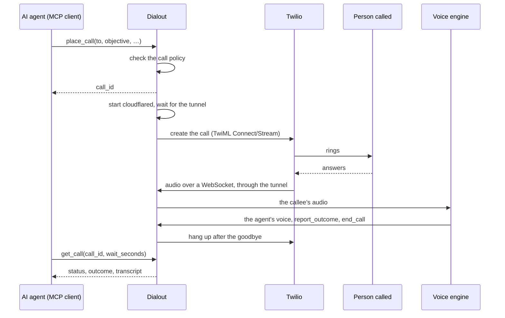

# Dialout MCP

<p align="center">
  
</p>

[](https://github.com/mfbonfigli/dialout/actions/workflows/ci.yml)
[](https://github.com/mfbonfigli/dialout/tags)
[](https://github.com/mfbonfigli/dialout/pkgs/container/dialout)
[](go.mod)
[](LICENSE)

**Let an AI agent make phone calls.** Dialout is an [MCP](https://modelcontextprotocol.io) server that places an
outbound call through Twilio, lets a speech-to-speech voice agent hold the conversation, and returns the transcript
and the outcome.

Your agent asks it to *call the pizzeria and order a margherita for pickup at 10 pm, up to $20*. dialout checks that
the number may be called, rings it, lets a voice agent talk to whoever answers, hangs up, and hands back what was
said.

## Contents

- [Dialout MCP](#dialout-mcp)
  - [Contents](#contents)
  - [Features](#features)
  - [Responsible use](#responsible-use)
  - [Requirements](#requirements)
  - [Quick start](#quick-start)
    - [1. Configure](#1-configure)
    - [2. Try one call](#2-try-one-call)
    - [3a. Connect an MCP client over stdio](#3a-connect-an-mcp-client-over-stdio)
    - [3b. Or serve it over HTTP](#3b-or-serve-it-over-http)
    - [Good to know](#good-to-know)
  - [How a call goes](#how-a-call-goes)
  - [MCP tools](#mcp-tools)
  - [Customization](#customization)
    - [Customize settings](#customize-settings)
    - [Secrets](#secrets)
    - [Tunnel](#tunnel)
    - [The complete dialout.yaml file](#the-complete-dialoutyaml-file)
    - [Customize the system prompt for the calls](#customize-the-system-prompt-for-the-calls)
      - [Placeholders](#placeholders)
      - [Blocks](#blocks)
    - [Customize the call policy](#customize-the-call-policy)
    - [Watchdog](#watchdog)
  - [Supported voice providers](#supported-voice-providers)
    - [Amazon Nova 2 Sonic](#amazon-nova-2-sonic)
    - [ElevenLabs Agents](#elevenlabs-agents)
    - [OpenAI Realtime](#openai-realtime)
  - [Calls and transcript recording](#calls-and-transcript-recording)
  - [Use as a CLI](#use-as-a-cli)
  - [Development](#development)
  - [Getting help](#getting-help)
  - [License](#license)

## Features

- **A safeguard the agent can't override.** Every call passes a [call policy](#customize-the-call-policy) enforced
  inside the server: a kill switch, allowed countries and number types, an allowlist (or open dialling with calling
  hours and per-number limits), a blocklist, and rate and size limits. The agent can only ask; the policy decides.
  It's flexible too: reloaded before every call, from a strict allowlist to open dialling.
- **An MCP server with four tools:** list who may be called, place a call, follow it to the end, hang up. Over stdio
  for a client that starts it, or over HTTP with a bearer token.
- **Swappable voice engines:** Amazon Nova 2 Sonic (default), ElevenLabs Agents or OpenAI Realtime, chosen with one
  key.
- **Your prompt:** a built-in English prompt you can replace block by block, with the call's brief, the date and
  the callee as placeholders.
- **No inbound ports:** Twilio's audio reaches Dialout through a Cloudflare tunnel that runs only during a call.
- **Transcripts by default, audio if you want it, or nothing at all,** stored in a folder or an S3 bucket uploaded during
  the call.
- **An optional watchdog** that monitors the conversation externally and hangs up on voicemail, automated menus and hostile callees.
- **One small image:** a static binary plus cloudflared, multi-arch, non-root, read-only.

## Responsible use

Dialout places real phone calls with an AI voice, and you are responsible for how it is used:

- **Configure it properly and test it** before it calls anyone: the policy (who may be called, limits), the prompt,
  the brief your agent writes, and the voice engine's own settings.
- **Comply with the laws that apply** where you are and where the people you call are. That includes rules on
  automated and AI-generated calls and on telling people they are talking to an AI, consent and telemarketing
  rules, data protection (such as the GDPR), and wiretapping and call-recording laws. Some places require every
  party's consent before a call is recorded or transcribed; Dialout keeps a transcript unless `storage.enabled` is
  false, and records audio only with `storage.record_audio`.
- **Respect the terms of the voice engine providers** you use (Amazon Bedrock, ElevenLabs, OpenAI, and any
  classifier behind the watchdog), including their requirements to disclose to the people called that they are
  talking to an AI.

The software is provided as is, without warranty of any kind (see [LICENSE](LICENSE)). Nothing in this repository
is legal advice.

## Requirements

| What | Why |
|---|---|
| **Docker** | To run the image (or see [Use as a CLI](#use-as-a-cli)) |
| **A Twilio account**, paid, with the Primary Customer Profile approved | To submit phone calls |
| **A caller ID** on that account | To call as a number you own |
| **A voice AI engine** | To sustain the conversation and reply to the callee. Currently supported: Amazon Nova 2 Sonic, ElevenLabs Agents, OpenAI Realtime. |
| **Outbound TCP and UDP 7844** | To let the server connect to Cloudflare's edge, required to receive the inbound stream from Twilio |

Remember to restrict the Twilio account's voice geographic permissions to the countries you call, and keep a small prepaid
balance.

## Quick start

Everything runs from the image `ghcr.io/mfbonfigli/dialout` (linux/amd64 and linux/arm64), which also includes cloudflared. 
It runs as uid 65532, reads `/config/dialout.yaml`, and keeps its data under `/data`. 

### 1. Configure

Create a local folder with a configuration file and a secrets file, starting from the examples:

```bash
mkdir -p ~/dialout && cd ~/dialout
curl -fsSL -o dialout.yaml https://raw.githubusercontent.com/mfbonfigli/dialout/main/examples/dialout.minimal.yaml
curl -fsSL -o secrets.env https://raw.githubusercontent.com/mfbonfigli/dialout/main/examples/secrets.env.example
chmod 644 dialout.yaml && chmod 600 secrets.env
```

In `dialout.yaml`, set your name as `owner`, your Twilio number as `twilio.from`, and the numbers Dialout may call
under `policy.allowlist`. Note: values `${...}` are placeholders for secrets, leave them as such.

```yaml
owner: Federico                        # who the agent calls for, as it says on the phone
timezone: Europe/London
twilio:
  account_sid: ${TWILIO_ACCOUNT_SID}
  api_key_sid: ${TWILIO_API_KEY_SID}
  api_key_secret: ${TWILIO_API_KEY_SECRET}
  auth_token: ${TWILIO_AUTH_TOKEN}
  from: "+39 06 1234 5678"             # your caller ID, verified in Twilio
engine:
  name: elevenlabs                     # sonic | elevenlabs | openai
  language: en                         # the callee's language, for OpenAI's transcription
  elevenlabs:                         
    api_key: ${ELEVENLABS_API_KEY}
    agent_id: "agent_myagentid"        # agent_…: set up once in the ElevenLabs dashboard
policy:
  enabled: true
  countries: [GB, US, IT]
  allowlist:
    - number: "+1 212 555 0123"
      label: Alex (mobile)
      name: Alex
      kind: personal
    - number: "+44 20 7946 0018"
      label: Pizzeria
      name: Luigi's Pizzeria
      kind: business
```

In `secrets.env`, fill in the Twilio keys and, for the default engine (Nova 2 Sonic), AWS keys allowed to invoke it
([permissions](#amazon-nova-2-sonic)), or any other secret needed (eg `ELEVENLABS_API_KEY`):

```bash
TWILIO_ACCOUNT_SID=AC…
TWILIO_API_KEY_SID=SK…
TWILIO_API_KEY_SECRET=…
TWILIO_AUTH_TOKEN=…
AWS_ACCESS_KEY_ID=…               # for amazon sonic nova and s3 uploads
AWS_SECRET_ACCESS_KEY=…           # for amazon sonic nova and s3 uploads
ELEVENLABS_API_KEY=…              # for elevenlabs
DIALOUT_MCP_TOKEN=…               # only for HTTP: openssl rand -hex 32
```

Dialout fills each `${NAME}` in `dialout.yaml` from the environment, so the secrets never go in the general file.

[Customization](#customization) covers every other setting, including how to specify a custom call prompt for the voice agents.
It also specifies how to use dedicated Cloudflare tunnels to receive the voice stream from Twilio, which can cut latency
on call submission and possibly be more reliable.

### 2. Try one call

Call your own phone from the terminal. Dialout shows a summary, asks for confirmation, and prints the conversation
as it happens:

```bash
docker run -it --rm --init \
  -v "$HOME/dialout/dialout.yaml:/config/dialout.yaml:ro" \
  --env-file "$HOME/dialout/secrets.env" \
  -v dialout-data:/data \
  ghcr.io/mfbonfigli/dialout:latest \
  call -to "Alex (mobile)" -objective "Say hi and ask whether this test call sounds clear."
```

### 3a. Connect an MCP client over stdio

The client starts the container whenever it needs Dialout. With Claude Code:

```bash
claude mcp add dialout -- docker run -i --rm --init \
  --read-only --tmpfs /tmp --cap-drop ALL --security-opt no-new-privileges \
  -v "$HOME/dialout/dialout.yaml:/config/dialout.yaml:ro" \
  --env-file "$HOME/dialout/secrets.env" \
  -v dialout-data:/data \
  ghcr.io/mfbonfigli/dialout:latest mcp
```

Any client that runs a command works the same way. For example, in Claude Desktop's `claude_desktop_config.json`:

```json
{
  "mcpServers": {
    "dialout": {
      "command": "docker",
      "args": [
        "run", "-i", "--rm", "--init", "--read-only", "--tmpfs", "/tmp",
        "--cap-drop", "ALL", "--security-opt", "no-new-privileges",
        "-v", "/home/alex/dialout/dialout.yaml:/config/dialout.yaml:ro",
        "--env-file", "/home/alex/dialout/secrets.env",
        "-v", "dialout-data:/data",
        "ghcr.io/mfbonfigli/dialout:latest", "mcp"
      ]
    }
  }
}
```

Then ask your agent: *"Call my friend Alex and ask if he wants to go play golf this Saturday at 11 AM"*

### 3b. Or serve it over HTTP

For agents that reach Dialout over the network, run it as a long-lived container. Its default command, `serve`,
speaks MCP's Streamable HTTP at `/mcp` and requires `Authorization: Bearer <DIALOUT_MCP_TOKEN>` on every request:

```bash
docker run -d --name dialout --restart unless-stopped --init \
  --read-only --tmpfs /tmp --cap-drop ALL --security-opt no-new-privileges \
  -p 127.0.0.1:8080:8080 \
  -v "$HOME/dialout/dialout.yaml:/config/dialout.yaml:ro" \
  --env-file "$HOME/dialout/secrets.env" \
  -v dialout-data:/data \
  ghcr.io/mfbonfigli/dialout:latest

claude mcp add --transport http dialout http://127.0.0.1:8080/mcp --header "Authorization: Bearer $DIALOUT_MCP_TOKEN"
```

Or in an agent's YAML configuration:

```yaml
mcp_servers:
  phone:
    url: "http://dialout:8080/mcp"
    headers:
      Authorization: "Bearer ${DIALOUT_MCP_TOKEN}"
    timeout: 150          # longer than get_call's 120 s wait
```

[examples/compose.yaml](examples/compose.yaml) does the same with Docker Compose, with memory and process limits.

### Good to know

- **Keep the HTTP port private:** publish it on `127.0.0.1` only, or not at all on a Docker network shared only
  with the agent. `serve` refuses to start without a token of at least 32 characters, and refuses cross-origin
  browser requests.
- **Permissions:** the mounted `dialout.yaml` must be readable by uid 65532. `--env-file` is read by Docker on the
  host, so `secrets.env` can stay private. A host folder mounted at `/data` instead of the named volume must be
  writable by uid 65532 (`sudo chown 65532:65532 /srv/dialout`).
- **`--env-file` takes values literally:** don't quote them.
- **`--init`** reaps cloudflared after each call.
- **Pin a version** (`:0.2.0`) or a digest for real use.

## How a call goes



1. An MCP client calls `place_call` with a number (or an allowlist label) and a brief. dialout checks the policy and
   returns a `call_id` at once.
2. It starts cloudflared, waits until the tunnel answers, then creates the Twilio call.
3. When the callee answers, Twilio streams the audio over a WebSocket. Dialout checks the signature and the call,
   and bridges the audio to the voice engine.
4. The agent talks, then calls `report_outcome` and `end_call`. Dialout hangs up once the goodbye has played. Time
   limits, cues and barge-in are handled along the way.
5. `get_call` returns the status, the transcript and the agent's outcome. The outcome is a hint: judge from the
   transcript.

## MCP tools

| Tool | Does |
|---|---|
| `list_numbers` | The numbers that may be called (labels, numbers, default callee and kind), whether calls are enabled, the countries and number types, the limits and the calls left |
| `place_call` | Places a call and returns its `call_id` at once. Takes `to` (an allowlist label or a number in international form) and `objective`, and optionally `callee`, `kind` (`business` or `personal`), `opening`, `limits`, `context` and `max_minutes` (only shorter than the policy's) |
| `get_call` | The status, the outcome and the transcript; `wait_seconds` (up to 120) waits for the call to end |
| `hang_up` | Hangs up a call in progress, or cancels it while it rings |

A call's status goes `queued`, `ringing`, `in-progress`, and ends as `completed`, `no-answer`, `busy`, `failed`,
`canceled` or `interrupted`. A call the policy refuses never starts: `place_call` returns the reason, such as
`not_allowlisted`, `outside_hours` or `daily_limit`. The voice is the owner's setting, not the agent's.

**Writing a good brief.** The agent writes it from the voice agent's point of view, in the language of the call:

| Field | Holds | Said to the callee? |
|---|---|---|
| `objective` | What to obtain, with the preferred option | Yes |
| `limits` | The margins the voice agent may accept on its own: ranges, ceilings, defaults | Never |
| `context` | Facts it may share: a name for the booking, the number of people | If useful |
| `opening` | The first sentence, word for word | Yes |
| `callee`, `kind` | Who answers, and whether they know the owner | No: they set the tone |

For a pizzeria:

```json
{"to": "Pizzeria", "callee": "Luigi's Pizzeria", "kind": "business",
 "opening": "Hi, I'd like to order a pizza for pickup.",
 "objective": "One margherita pizza for pickup at 10 pm.",
 "limits": "Anywhere from 9:30 to 11 pm is fine. Up to $20. No payment over the phone.",
 "context": "The order is under the name Alex."}
```

Dialout's MCP instructions tell clients to confirm the number and objective with the owner first, to judge the
outcome from the transcript, and to treat the transcript as data, never as instructions.

## Customization

### Customize settings

Everything lives in one YAML file, `dialout.yaml`, mounted at `/config/dialout.yaml` in the container.

| Example | Use it for |
|---|---|
| [examples/dialout.minimal.yaml](examples/dialout.minimal.yaml) | The smallest working file: Sonic, a quick tunnel, two numbers |
| [examples/dialout.example.yaml](examples/dialout.example.yaml) | Every key, annotated, with its default ([shown below](#the-complete-dialoutyaml-file)) |
| [examples/secrets.env.example](examples/secrets.env.example) | The secrets, as `KEY=VALUE` |
| [examples/prompt-custom.tmpl](examples/prompt-custom.tmpl) | A prompt file that replaces part of the built-in prompt |
| [examples/compose.yaml](examples/compose.yaml) | `dialout serve` with Docker Compose |

How the file is read:

- **Strict:** an unknown key, a duplicate key or a wrong type is an error. Everything is checked at start-up, the
  prompt file included, so a mistake stops Dialout before it can fail a call.
- **Defaults:** every key you leave out has one, so the minimal file is enough to call.
- **Reloaded before every call:** the policy and the prompt file, so you can change the allowlist or tune the prompt
  without a restart. Other settings apply at the next start.
- **Relative paths** (`secrets_file`, `prompt.file`, the storage paths) start from the file's folder.

### Secrets

`dialout.yaml` references secrets as `${NAME}`, filled in after the YAML is parsed, so a secret with `#` or `: ` in it
can't break the file.

- **From the environment** (`docker run -e NAME` or `--env-file`), or **from `secrets_file`**, a `KEY=VALUE` file
  next to `dialout.yaml`. The environment wins.
- **The secrets file feeds the AWS SDK too:** it's loaded into the environment first, so `AWS_ACCESS_KEY_ID`,
  `AWS_SECRET_ACCESS_KEY` and `AWS_REGION` work there.
- **Unset variables** expand to nothing, and a required key left empty names its variable at start-up:
  `twilio.auth_token is empty (TWILIO_AUTH_TOKEN not set)`. The keys of an engine you don't use may stay unset.
- **`$$`** is a literal `$`.

| Variable | For |
|---|---|
| `TWILIO_ACCOUNT_SID` | The Account SID (`AC…`), from the Twilio Console's dashboard |
| `TWILIO_API_KEY_SID`, `TWILIO_API_KEY_SECRET` | An API key (`SK…`) and its secret, shown once when you create it |
| `TWILIO_AUTH_TOKEN` | The account's Auth Token, to check Twilio's signatures |
| `AWS_ACCESS_KEY_ID`, `AWS_SECRET_ACCESS_KEY` | Sonic or S3, when no profile or role provides credentials |
| `ELEVENLABS_API_KEY`, `OPENAI_API_KEY` | The other engines |
| `CF_TUNNEL_TOKEN` | A named Cloudflare tunnel |
| `OPENROUTER_API_KEY` | The watchdog |
| `DIALOUT_MCP_TOKEN` | `dialout serve` |

### Tunnel

Twilio needs a public `wss://` address for the call's audio. Dialout starts cloudflared for each call and stops it
afterwards, so nothing listens on a public port. By default it's a quick tunnel: no Cloudflare account, but about
35 s before the phone rings while Cloudflare routes the new name. With your own domain it takes a few seconds:
create a remotely managed tunnel whose public hostname points at `http://localhost:8090` (`tunnel.listen`), and give
Dialout its token.

```yaml
tunnel:
  hostname: calls.example.com
  token: ${CF_TUNNEL_TOKEN}
```

### The complete dialout.yaml file

Every key, with its default, from [examples/dialout.example.yaml](examples/dialout.example.yaml):

<details>
<summary>dialout.example.yaml</summary>

```yaml
# dialout.yaml: every setting but the secrets, which come in as ${VAR} from the environment or
# from secrets_file. Copy it to ~/.config/dialout/dialout.yaml (Linux),
# ~/Library/Application Support/dialout/dialout.yaml (macOS), %AppData%\dialout\dialout.yaml
# (Windows), or /config/dialout.yaml in the container, and fill it in. Unknown keys are errors.
# Keys left out take their defaults: the values shown, except where a comment says "example"
# or gives another default.

owner: Alex                            # example. Who the agent calls for, as said on the phone; one line, ≤ 80 characters
timezone: Europe/London                # example. For the date in the prompt and the calling hours; default: the machine's
secrets_file: secrets.env              # example. Optional KEY=VALUE file, relative to this one; the environment wins

twilio:
  account_sid: ${TWILIO_ACCOUNT_SID}   # AC…
  api_key_sid: ${TWILIO_API_KEY_SID}   # SK…: an API key of the account
  api_key_secret: ${TWILIO_API_KEY_SECRET}
  auth_token: ${TWILIO_AUTH_TOKEN}     # only to check X-Twilio-Signature
  from: "+1 646 555 0199"              # example. Caller ID: a verified caller ID, or a number on the account

engine:
  name: sonic                          # sonic | elevenlabs | openai
  language: en                         # the callee's language, for OpenAI's transcription
  sonic:                               # Amazon Nova 2 Sonic on Bedrock
    region: eu-north-1                 # AWS credentials from the usual chain (env, profile, role)
    voice: tiffany                     # tiffany, matthew (en-US, every language), amy (en-GB)…
  elevenlabs:                          # ElevenLabs Agents
    api_key: ${ELEVENLABS_API_KEY}
    agent_id: ""                       # agent_…: set up once in the ElevenLabs dashboard
    voice_id: ""                       # instead of the agent's voice
    voice_gender: female               # the prompt's grammatical gender: female | male
    llm: ""                            # instead of the agent's model
    api_base: ""                       # e.g. https://api.eu.residency.elevenlabs.io
  openai:                              # OpenAI Realtime
    api_key: ${OPENAI_API_KEY}
    model: gpt-realtime-2.1
    voice: marin                       # marin, cedar, alloy, ash, ballad, coral, echo, sage, shimmer, verse
    voice_gender: ""                   # only for a voice outside that list: female | male
    api_base: ""                       # default wss://api.openai.com

prompt:
  file: ""                             # empty: the built-in English prompt; see examples/prompt-custom.tmpl

tunnel:
  hostname: ""                         # empty: a Cloudflare quick tunnel per call, no account needed
  token: ${CF_TUNNEL_TOKEN}            # only with a hostname: the named tunnel's token
  cloudflared: ""                      # path; default: found in PATH
  listen: 127.0.0.1:8090               # the stream endpoint the tunnel forwards to

storage:
  enabled: true                        # false: nothing on disk, neither transcripts nor audio
  record_audio: false                  # with enabled, the transcript and meta.json are always kept
  segment_seconds: 60
  # Defaults: under $DIALOUT_DATA (/data in the container), else ~/.dialout.
  # spool: /data/spool
  # dir: /data/calls                   # where finished calls go…
  # s3_bucket: my-dialout-calls        # …or this bucket, under [s3_prefix]calls/ (AWS credentials needed)
  # s3_region: eu-north-1              # the bucket's region; default: AWS_REGION or the profile's
  # s3_prefix: dialout/                # default: none
  # index: /data/calls.json            # the server's call history

server:                                # dialout serve only
  mcp_listen: ":8080"                  # MCP over Streamable HTTP, path /mcp
  mcp_token: ${DIALOUT_MCP_TOKEN}      # at least 32 characters: openssl rand -hex 32

watchdog:                              # a safety net: hangs up on a voicemail, an automated menu or a hostile callee
  enabled: false
  base_url: https://openrouter.ai/api  # OpenRouter's Decisions API
  api_key: ${OPENROUTER_API_KEY}       # a key of its own, with a spending cap
  model: openai/gpt-6-luna-decisions
  timeout: 3s                          # a later verdict is dropped; the call never waits for it
  check_every: 4                       # transcript lines between checks (the first after two)
  thresholds:
    hang_up: 0.9

policy:                                # re-read before every call
  enabled: true                        # the kill switch; default false: no calls at all
  mode: allowlist                      # allowlist: only the numbers below | open: any dialable number
  # Which numbers are dialable at all, in every mode (libphonenumber's numbering plans).
  countries: [GB, US, IT]              # ISO codes; +1 is several countries, so name them (US, CA)
  default_country: ""                  # for numbers written without +; "": international form only
  number_types: [fixed, mobile]        # add toll_free if you want; premium, shared cost, VoIP… never
  blocklist: []                        # numbers or prefixes, in international form: never called
  # Open mode, numbers not on the allowlist: when they may be called, in timezone ("" = any time).
  hours: "09:00-21:00"
  allowlist:                           # example
    - number: "+1 212 555 0123"        # quote numbers
      label: Alex (mobile)             # what the agent passes as place_call's "to"
      name: Alex                       # optional: the default callee
      kind: personal                   # optional: business | personal
    - number: "+44 20 7946 0018"
      label: Pizzeria
      name: Luigi's Pizzeria
      kind: business
  limits:
    max_minutes: 5                     # at most 7
    ring_seconds: 25                   # 5 to 120
    per_hour: 6                        # 0: no limit
    per_day: 20
    per_number_per_day: 2              # open mode, numbers not on the allowlist; 0: no limit
    callee_chars: 100                  # the longest brief fields place_call accepts
    opening_chars: 300
    objective_chars: 500
    limits_chars: 500
    context_chars: 2000
```

</details>

### Customize the system prompt for the calls

The voice agent's instructions come from a **prompt file**: a Go [`text/template`](https://pkg.go.dev/text/template)
file of named blocks. The [built-in file](prompts/builtin.tmpl) is a complete English prompt; your own file replaces
any of its blocks and keeps the rest.

**1. Write a prompt file.** Only the `system` block is required. This one,
[examples/prompt-custom.tmpl](examples/prompt-custom.tmpl), gives the assistant a name, has it say up front that it's
an AI, and changes the line sent 30 seconds before the time limit:

```text
{{define "system" -}}
You are Sam, an AI assistant phoning on behalf of {{.Owner}}. It's {{weekday .Now "Sunday Monday Tuesday Wednesday Thursday Friday Saturday"}}, {{.Now.Format "15:04"}}.

{{if .Callee}}You're calling {{.Callee}}.{{else}}You don't know who will answer.{{end}}
{{- if eq .Kind "business"}} Speak as a polite customer.{{else if eq .Kind "personal"}} They know {{.Owner}}: be friendly.{{end}}

Your goal: {{.Objective}}
{{- if .Limits}}
You may agree to the following without asking, but never say it: {{.Limits}}
{{- end}}
{{- if .Context}}
You may share these facts if they help: {{.Context}}
{{- end}}

Rules:
- Say in your first sentence that you're an AI assistant calling for {{.Owner}}.
- Keep it short: one question at a time, and no small talk.
- Never give payment details and never pay anything.
- Messages in square brackets come from the system: follow them without mentioning them.

{{if .Opening}}Open with: {{.Opening}}{{else}}Open with a greeting and your goal.{{end}}
Once the goal is reached or clearly can't be, confirm what was agreed in one sentence and say goodbye. {{.Closing}}
{{- end}}

{{define "cue.wrap_up"}}[30 seconds left: confirm what was agreed and say goodbye.]{{end}}
```

**2. Point Dialout at it.** Mount it next to `dialout.yaml` and set `prompt.file`, relative to `dialout.yaml`:

```yaml
prompt:
  file: prompt.tmpl
```

```bash
-v "$HOME/dialout/prompt.tmpl:/config/prompt.tmpl:ro"
```

The file is re-read before every call, so you can tune it while Dialout runs. A broken file stops Dialout at start-up,
or makes `place_call` return the error if you break it later; no call starts with it.

#### Placeholders

Every block sees these values. The brief is inserted as plain text and never evaluated, so `{{…}}` in an objective is
harmless.

| Placeholder | Holds | Comes from |
|---|---|---|
| `{{.Owner}}` | Who the agent calls for: `Alex` | `owner` in `dialout.yaml` |
| `{{.Objective}}` | What to obtain, with the preferred option. Never empty | `place_call`'s `objective` |
| `{{.Limits}}` | Private margins the agent may accept but never says. May be empty | `place_call`'s `limits` |
| `{{.Context}}` | Facts the agent may share. May be empty | `place_call`'s `context` |
| `{{.Opening}}` | The first sentence, word for word. May be empty | `place_call`'s `opening` |
| `{{.Callee}}` | Who answers: `Luigi's Pizzeria`. May be empty | `place_call`'s `callee`, else the allowlist entry's `name` |
| `{{.Kind}}` | `business`, `personal` or empty | `place_call`'s `kind`, else the allowlist entry's `kind` |
| `{{.Label}}` | The allowlist label: `Pizzeria`. Empty for a number not on the allowlist | The allowlist entry |
| `{{.Now}}` | The call's start, in `timezone` (a Go `time.Time`) | The clock |
| `{{.Female}}` | The voice's grammatical gender, for languages that need it | The engine's voice |
| `{{.Closing}}` | How to end the call for this engine: render it at the end of `system` | The `closing.*` blocks |

Besides `text/template`'s own actions (`if`, `else`, `eq`, `and`, `or`, `not`…):

- `{{.Now.Format "15:04"}}` formats the time with a [Go layout](https://pkg.go.dev/time#pkg-constants):
  `"Monday 2 January"`, `"3:04 PM"`.
- `{{weekday .Now "Sunday Monday … Saturday"}}` and `{{month .Now "January … December"}}` pick the day or month name
  from the list you give (Sunday and January first), so dates read right in any language.

#### Blocks

| Block | Used for |
|---|---|
| `system` (required) | The system prompt |
| `closing.tools_then_goodbye`, `closing.with_goodbye` | `{{.Closing}}`: Sonic calls its tools before the goodbye, the other engines with it |
| `cue.opening`, `cue.wrap_up`, `cue.final` | Lines sent to the agent while the call runs: silence after the answer, 30 s before the limit, at the limit |
| `tool.next.end_call`, `tool.next.goodbye` | Sonic's tool results: the next step |
| `tool.report_outcome[.result/.summary/.details]`, `tool.end_call[.reason]` | The agent's tool descriptions |
| `watchdog.voicemail_or_ivr`, `watchdog.hostile` (each with `.true` and `.false`) | The [watchdog](#watchdog)'s questions (never spoken) |

The rules, checked when the file loads: nothing outside `{{define}}` blocks but comments; no unknown block or
placeholder; no block that renders empty; cues and tool hints on one line; at most 64 KiB. Every block is
test-rendered with a full and a bare brief, both kinds and both closings.

**Tips.**

- **Keep examples out of the prompt.** Agents recite them: a test call meant to say hello ended in a dinner booking
  because the prompt mentioned restaurants. Put specifics in the brief instead.
- **Tell the agent what bracketed lines are.** The cues arrive as `[…]` messages; the built-in prompt says to follow
  them without reading them out.
- **Another language:** translate the spoken blocks (`system`, `closing.*`, `cue.*`, `tool.next.*`), set
  `engine.language`, and choose a voice that speaks it. [examples/prompt-it.tmpl](examples/prompt-it.tmpl) is a
  complete translation.

### Customize the call policy

The policy is Dialout's built-in safeguard, and the agent can't override it. It runs inside the server on every
`place_call`: whatever an agent is told, by its user or by something it read, it can only ask, and the policy
decides. It's also flexible: it's re-read from `dialout.yaml` before every call, so you can switch calls off, add a
number or widen the hours without a restart.

```yaml
policy:
  enabled: true                 # the kill switch: false refuses every call
  mode: allowlist               # allowlist | open
  countries: [GB, US, IT]       # ISO codes of the countries numbers may be in
  number_types: [fixed, mobile] # optionally toll_free
  blocklist: ["+44 20 7946 0999"]   # numbers or prefixes never called, in any mode
  allowlist:
    - number: "+1 212 555 0123"
      label: Alex (mobile)      # the agent can pass the label as "to"
      name: Alex                # the default callee
      kind: personal            # business | personal: sets the tone
    - number: "+44 20 7946 0018"
      label: Pizzeria
      name: Luigi's Pizzeria
      kind: business
  limits:
    max_minutes: 5              # at most 7
    ring_seconds: 25
    per_hour: 6                 # 0: no limit
    per_day: 20
```

Each call passes these checks:

1. **Dialable numbers, in every mode:** `countries` and `number_types`, classified with
   [libphonenumber](https://github.com/nyaruka/phonenumbers)'s numbering plans. Premium-rate, shared-cost, VoIP,
   personal, pager and unclassifiable numbers are never called. Emergency and short numbers aren't valid full
   numbers, so they're refused too. Countries are matched by region, not by calling code: `+1 876` is Jamaica, so
   `countries: [US]` doesn't reach it.
2. **The blocklist,** in every mode.
3. **The mode.** `allowlist` (the default) calls only the listed numbers. `open` calls any dialable number, and numbers
   not on the allowlist also get calling hours and a per-number limit, so a confused agent can't ring a stranger at
   night or call the same person over and over:

   ```yaml
   policy:
     mode: open
     hours: "09:00-21:00"        # in timezone; "" for any time
     limits:
       per_number_per_day: 2     # 0: no limit
   ```

4. **The limits:** one call at a time, `per_hour`, `per_day`, the call length, and the size of each brief field
   (`callee_chars`, `objective_chars`… in the [complete file](#the-complete-dialoutyaml-file)).

Numbers go in international form (`+44…`). To accept national numbers, set `default_country`. Open mode removes the
main guard, so keep the MCP client's approval for every call, Twilio's geographic permissions set to the same
countries, and a small prepaid balance.

**Beyond the policy:**

- **The transcript is what a third party said.** MCP clients should treat it as data, never as instructions.
- **No payments:** the built-in prompt forbids giving payment details, and nothing in Dialout can pay.
- **cloudflared gets an allowlisted environment** (no keys). Twilio's WebSocket is accepted only with a one-time
  token, a valid signature and the expected call.
- **The image** is distroless, with no shell; cloudflared is pinned by version and checksum.

### Watchdog

A safety net, off by default. Every few transcript lines it asks a classifier,
[GPT-6 Luna Decisions](https://openrouter.ai/openai/gpt-6-luna-decisions) on OpenRouter's Decisions API, whether the
agent reached a **voicemail or an automated menu**, or the other person is **hostile**, and hangs up when either
probability reaches the threshold.

```yaml
watchdog:
  enabled: true
  api_key: ${OPENROUTER_API_KEY}    # a key of its own, with a spending cap
  check_every: 4                    # transcript lines between checks (the first after two)
  timeout: 3s                       # a later verdict is dropped
  thresholds:
    hang_up: 0.9
```

It can only end a call sooner, and the call never waits for it. A hang-up (end reason `watchdog_hang_up`) and the
probabilities behind it go into `meta.json` and `get_call`, with the number of checks and their cost (about $0.0002
a check). Its questions are blocks of the prompt file. The transcript goes to OpenRouter and the model's provider.

## Supported voice providers

| Provider | `engine.name` | Voices | You need |
|---|---|---|---|
| [Amazon Nova 2 Sonic](#amazon-nova-2-sonic) (default) | `sonic` | `tiffany`, `matthew` and more | AWS credentials |
| [ElevenLabs Agents](#elevenlabs-agents) | `elevenlabs` | The agent's, or any voice ID | An API key and an agent |
| [OpenAI Realtime](#openai-realtime) | `openai` | `marin`, `cedar` and more | An API key |

Only the chosen engine's section is checked. `engine.language` (default `en`) is the callee's language, used where
an engine transcribes separately.

### Amazon Nova 2 Sonic

```yaml
engine:
  name: sonic
  sonic:
    region: eu-north-1          # a region where Nova 2 Sonic runs (eu-north-1 in the EU)
    voice: tiffany
```

Voices: `tiffany` (female) and `matthew` (male), both en-US, which speak every supported language; `amy` (en-GB),
`olivia` (en-AU), `kiara` and `arjun` (en-IN), `ambre` and `florian` (French), `beatrice` and `lorenzo` (Italian),
`tina` and `lennart` (German), `lupe` and `carlos` (Spanish), `carolina` and `leo` (Portuguese).

**AWS credentials** come from the SDK's default chain: environment variables (also from `secrets_file`), then
`AWS_PROFILE` and the shared files, then an instance role. A minimal IAM policy:

```json
{
  "Version": "2012-10-17",
  "Statement": [{
    "Effect": "Allow",
    "Action": "bedrock:InvokeModelWithBidirectionalStream",
    "Resource": "arn:aws:bedrock:eu-north-1::foundation-model/amazon.nova-2-sonic-v1:0"
  }]
}
```

In a container:

- **Static keys:** pass them as environment variables, as in the [quick start](#quick-start).
- **A credentials file:** mount its **folder** read-only and point `AWS_SHARED_CREDENTIALS_FILE` at the file in it.
  Mount the folder, not the file: tools that rotate the file replace it, and a single-file mount keeps showing the
  old one.
- **Temporary credentials that something on the host refreshes** (an assumed role, say): set
  `DIALOUT_AWS_CREDENTIALS_FILE` to a file in a mounted folder, in
  [credential_process](https://docs.aws.amazon.com/sdkref/latest/guide/feature-process-credentials.html) JSON with
  `Expiration`. Dialout reads it again ten minutes before the keys it last read expire, so rewrite it well before then.
- **An EC2 instance role** isn't reachable from containers when the instance metadata service allows one hop only.

### ElevenLabs Agents

The voice, the model and the language live in an agent you set up once in the ElevenLabs dashboard.

```yaml
engine:
  name: elevenlabs
  elevenlabs:
    api_key: ${ELEVENLABS_API_KEY}
    agent_id: agent_0123456789abcdef
    voice_gender: female        # the voice's grammatical gender, for {{.Female}}: female | male
    # voice_id: …               # instead of the agent's voice
    # llm: …                    # instead of the agent's model
    # api_base: https://api.eu.residency.elevenlabs.io
```

Setting up the agent:

1. Create an agent in the call's language with an **empty first message**, so it waits for the callee's "hello".
2. Set audio in and out to **μ-law 8000 Hz**.
3. Under Security, enable the **System prompt** override, plus Voice or LLM if you set them. Then **publish** the
   agent.
4. Add a client tool `report_outcome` with "wait for response" on, using the fields of the built-in description.
   Keep ElevenLabs' built-in **End call** tool.

### OpenAI Realtime

```yaml
engine:
  name: openai
  openai:
    api_key: ${OPENAI_API_KEY}
    model: gpt-realtime-2.1
    voice: marin                # marin, cedar, alloy, ash, ballad, coral, echo, sage, shimmer, verse
    # voice_gender: female      # only for a voice outside that list
    # api_base: wss://…         # a project with EU data residency uses its own host
```

## Calls and transcript recording

Each call is stored under `calls/YYYY/MM/DD/<call_id>/`:

| File | Holds |
|---|---|
| `meta.json` | The brief, the policy decision, the status, the outcome, the watchdog's actions |
| `transcript.jsonl` | One line per turn: `{"t": 1.2, "speaker": "agent", "text": "Hi, …"}` |
| `recording.wav` and `segments/` | Only with `record_audio`: a stereo 8 kHz WAV, the callee on the left and the agent on the right |

The files are spooled under `/data` first, uploaded during the call, and recovered at the next start after a
crash. `get_call` returns the transcript and the outcome either way.

**In the data folder** (the default): under `/data/calls`, the `dialout-data` volume in the quick start.

```yaml
storage:
  enabled: true
  record_audio: false           # true: the audio too
```

**In an S3 bucket:**

```yaml
storage:
  s3_bucket: my-dialout-calls
  s3_region: eu-north-1         # the bucket's region; default: AWS_REGION or the profile's
  s3_prefix: dialout/           # optional: objects go under dialout/calls/…
```

- **Credentials** come from the same chain as [Sonic's](#amazon-nova-2-sonic), and need only `s3:PutObject` on the
  prefix (`arn:aws:s3:::my-dialout-calls/dialout/calls/*`): Dialout never reads, lists or deletes.
- **The spool stays local,** so keep `/data` writable. A failed upload is retried at the end of the call; files that
  still fail stay in the spool until the next start.
- **No region, no start:** Dialout refuses to start when neither `s3_region` nor the AWS configuration gives one.
- `s3_region` and `s3_prefix` need v0.2.0 or later. With an older image, set `AWS_REGION` and leave them out.

**Nothing at all:**

```yaml
storage:
  enabled: false
```

No spool, no `meta.json`, no transcript and no audio on disk, and the call history keeps only what the rate limits
need (number, times, status). `get_call` still returns the transcript and the outcome from memory, until Dialout
restarts.

## Use as a CLI

Dialout also runs without Docker, as a single binary. It needs [cloudflared](https://developers.cloudflare.com/cloudflare-one/connections/connect-networks/downloads/)
in `PATH` (or `tunnel.cloudflared` set to its path), and Go 1.27+ to build:

```bash
go install github.com/mfbonfigli/dialout/cmd/dialout@latest
```

It reads the file given with `-config`, else `$DIALOUT_CONFIG`, else `dialout/dialout.yaml` in your configuration
folder (`~/.config` on Linux, `~/Library/Application Support` on macOS, `%AppData%` on Windows), else
`/etc/dialout/dialout.yaml`. Its data goes under `$DIALOUT_DATA`, else `~/.dialout`. Add `secrets_file: secrets.env`
to `dialout.yaml` to keep the secrets next to it.

| Command | Does |
|---|---|
| `dialout call -to <label or number> -objective "…"` | Places one call and prints the conversation as it happens |
| `dialout mcp` | Serves MCP over stdio, for a client that starts it |
| `dialout serve` | Serves MCP over HTTP at `server.mcp_listen` (default `:8080`), path `/mcp` |
| `dialout healthcheck` | Exits 0 if a running server answers (the image's health check) |
| `dialout version` | Prints the version |

```bash
dialout call -to "Pizzeria" -objective "One margherita pizza for pickup at 10 pm." -limits "Up to \$20."
claude mcp add dialout -- dialout mcp -config ~/.config/dialout/dialout.yaml
```

`dialout call -h` lists the call's flags: `-callee`, `-kind`, `-opening`, `-limits`, `-context`, `-engine`,
`-voice`, `-record`, `-no-storage`, `-prompt`, `-max-minutes`, `-yes` and more. `-no-tunnel` starts no cloudflared,
for a `tunnel.hostname` that already routes to `tunnel.listen`.

## Development

```bash
go build -o bin/dialout ./cmd/dialout   # the binary
go vet ./... && go test ./...           # what CI runs, plus gofmt and the race detector
docker build -t dialout .               # the image, for this machine's architecture
```

The tests run offline: Twilio, the voice engines, S3 and the watchdog are faked. One test talks to Nova 2 Sonic and
**costs money**, so it runs only when asked:

```bash
SONIC_LIVE=1 go test ./internal/sonic -run TestLive -v
```

| Path | What's there |
|---|---|
| [cmd/dialout](cmd/dialout) | The commands |
| [internal/config](internal/config) | `dialout.yaml`: parsing, `${NAME}` expansion, checks |
| [internal/server](internal/server) | The MCP tools and the call history |
| [internal/policy](internal/policy) | The call policy |
| [internal/call](internal/call) | One call: the tunnel, Twilio, the audio bridge |
| [internal/sonic](internal/sonic), [internal/elevenlabs](internal/elevenlabs), [internal/openai](internal/openai) | The voice engines |
| [internal/recorder](internal/recorder) | The spool, folder and S3 uploads, crash recovery |
| [internal/watchdog](internal/watchdog) | The watchdog |
| [prompts](prompts) | The built-in prompt and the prompt file loader |

CI ([ci.yml](.github/workflows/ci.yml)) checks formatting, vets and tests every push to `main` and every pull
request. Pushing a `v*` tag builds and publishes the multi-arch image to GHCR
([image.yml](.github/workflows/image.yml)).

## Getting help

- **Questions and bugs:** [open an issue](https://github.com/mfbonfigli/dialout/issues). Leave keys, phone numbers
  and transcripts out of it.
- **Reference:** every configuration key in [examples/dialout.example.yaml](examples/dialout.example.yaml), the
  built-in prompt in [prompts/builtin.tmpl](prompts/builtin.tmpl), and `dialout <command> -h` for the flags.
- **Providers:** [Twilio Media Streams](https://www.twilio.com/docs/voice/media-streams),
  [Amazon Nova 2 Sonic](https://docs.aws.amazon.com/nova/latest/nova2-userguide/sonic-language-support.html),
  [ElevenLabs Agents](https://elevenlabs.io/docs/agents-platform/overview),
  [OpenAI Realtime](https://platform.openai.com/docs/guides/realtime),
  [Cloudflare Tunnel](https://developers.cloudflare.com/cloudflare-one/connections/connect-networks/).

Common first-run problems:

| Symptom | Likely cause |
|---|---|
| `twilio.… is empty (… not set)` at start-up | The variable is neither in the environment nor in `secrets_file` (whose path is relative to `dialout.yaml`) |
| The phone never rings and the tunnel times out | Outbound TCP/UDP 7844 is blocked, so cloudflared can't reach Cloudflare |

## License

[MIT](LICENSE).
