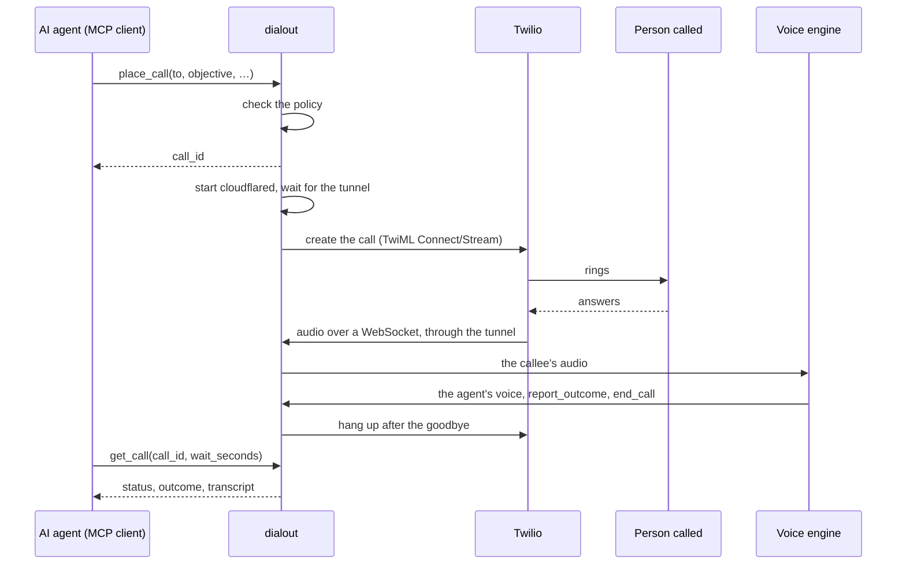

# dialout

[](https://github.com/mfbonfigli/dialout/actions/workflows/ci.yml)
[](https://github.com/mfbonfigli/dialout/tags)
[](https://github.com/mfbonfigli/dialout/pkgs/container/dialout)
[](go.mod)
[](LICENSE)

**Let an AI agent make phone calls.** dialout is an [MCP](https://modelcontextprotocol.io) server, and a
command-line tool, that places an outbound call through Twilio, lets a speech-to-speech voice agent hold the
conversation, and returns the transcript and the outcome.

Your agent asks it to *call the pizzeria and order a margherita for 10 pm, up to €20*. dialout checks that the
number may be called, rings it, lets a voice agent talk to whoever answers, hangs up, and hands back what was said.

> **Status: early.** The call engine has been used on real calls; the MCP server, the YAML configuration and the
> prompt file are newer. Out of the box only **Italian** fixed and mobile numbers on the allowlist can be called,
> and the built-in prompt is Italian (an [English prompt](examples/prompt-en.tmpl) is included).

## Contents

- [Features](#features)
- [Responsible use](#responsible-use)
- [How a call goes](#how-a-call-goes)
- [Requirements](#requirements)
- [Quick start](#quick-start)
- [Run it as an MCP server](#run-it-as-an-mcp-server)
- [Configuration](#configuration)
- [MCP tools](#mcp-tools)
- [Security model](#security-model)
- [Development](#development)
- [Getting help](#getting-help)
- [License](#license)

## Features

- **Swappable voice engines:** Amazon Nova 2 Sonic (default), ElevenLabs Agents or OpenAI Realtime, chosen with one
  key.
- **No inbound ports:** Twilio's audio reaches dialout through a Cloudflare tunnel that runs only during a call: a
  quick tunnel with no account needed, or your own hostname.
- **A policy in front of every call,** enforced by the server and not by the agent that asks: a kill switch,
  allowed countries and number types, an allowlist (or open dialling with calling hours and per-number limits), a
  blocklist, rate limits and size limits.
- **Transcripts by default, audio if you want it, or nothing at all.** Calls are stored in a folder or an S3
  bucket, uploaded during the call and recovered after a crash. With `storage.enabled: false` nothing of the
  conversation touches the disk.
- **Your prompt:** a built-in prompt you can replace block by block with a template file, checked at start-up.
- **An optional watchdog** that hangs up on voicemail, automated menus and hostile callees.
- **One small image:** a static binary plus cloudflared, multi-arch, non-root, read-only. MCP over stdio, or over
  HTTP with a bearer token.

## Responsible use

dialout places real phone calls with an AI voice, and you are responsible for how it is used:

- **Configure it properly and test it** before it calls anyone: the policy (who may be called, limits), the prompt,
  the brief your agent writes, and the voice engine's own settings.
- **Comply with the laws that apply** where you are and where the people you call are. That includes rules on
  automated and AI-generated calls and on telling people they are talking to an AI, consent and telemarketing
  rules, data protection (such as the GDPR), and wiretapping and call-recording laws. Some places require every
  party's consent before a call is recorded or transcribed; dialout keeps a transcript unless `storage.enabled` is
  false, and records audio only with `storage.record_audio`.
- **Respect the terms of the voice engine providers** you use (Amazon Bedrock, ElevenLabs, OpenAI, and any
  classifier behind the watchdog), including their requirements to disclose to the people called that they are
  talking to an AI.

The software is provided as is, without warranty of any kind (see [LICENSE](LICENSE)). Nothing in this repository
is legal advice.

## How a call goes



1. An MCP client calls `place_call` with a number (or an allowlist label) and a brief. dialout checks the policy and
   returns a `call_id` at once.
2. It starts cloudflared, waits until the tunnel answers, then creates the Twilio call.
3. When the callee answers, Twilio streams the audio over a WebSocket. dialout checks the signature and the call,
   and bridges the audio to the voice engine.
4. The agent talks, then calls `report_outcome` and `end_call`. dialout hangs up once the goodbye has played. Time
   limits, cues and barge-in are handled along the way.
5. `get_call` returns the status, the transcript and the agent's outcome. The outcome is a hint: judge from the
   transcript.

## Requirements

| What | Why |
|---|---|
| **A Twilio account**, paid, with the Primary Customer Profile approved | Trial accounts can't stream audio, and the API refuses calls until the profile is approved |
| **A caller ID** on that account | A verified number of yours, or one bought on the account |
| **A voice engine** | AWS credentials allowed to invoke Nova 2 Sonic (`eu-north-1` in the EU), or an ElevenLabs API key and agent, or an OpenAI API key |
| **Outbound TCP and UDP 7844** | cloudflared connects to Cloudflare's edge on that port: a firewall that allows only 80 and 443 out breaks every call |
| **cloudflared** in `PATH` | For the binary only: the image includes it |
| **Go 1.25+** | Only to build from source |

Restrict the Twilio account's voice geographic permissions to the countries you call, and keep a small prepaid
balance.

## Quick start

Place one call from your machine with the command-line tool. It uses the same engine and policy as the server.

**1. Install dialout** and [cloudflared](https://developers.cloudflare.com/cloudflare-one/connections/connect-networks/downloads/):

```bash
go install github.com/mfbonfigli/dialout/cmd/dialout@latest
```

Or build it from a clone with `go build -o bin/dialout ./cmd/dialout`, or skip the binary and use the
[Docker image](#stdio-in-docker).

**2. Write the configuration**, starting from the minimal example and the secrets template:

```bash
mkdir -p ~/.config/dialout
curl -fsSL -o ~/.config/dialout/dialout.yaml https://raw.githubusercontent.com/mfbonfigli/dialout/main/examples/dialout.minimal.yaml
curl -fsSL -o ~/.config/dialout/secrets.env https://raw.githubusercontent.com/mfbonfigli/dialout/main/examples/secrets.env.example
```

(From a clone, copy [examples/dialout.minimal.yaml](examples/dialout.minimal.yaml) and
[examples/secrets.env.example](examples/secrets.env.example) instead.)

In `dialout.yaml`, set your name as `owner`, your caller ID as `twilio.from`, and the numbers you'll call under
`policy.allowlist`. Then point it at the secrets file with one more line:

```yaml
secrets_file: secrets.env    # relative to dialout.yaml
```

Fill in the Twilio keys in `secrets.env`, and AWS credentials there too if no AWS profile provides them (Sonic is
the default engine). [Configuration](#configuration) covers everything else.

**3. Call:**

```bash
dialout call -to "Marco (mobile)" -objective "Chiedigli a che ora arriva stasera."
```

dialout shows a summary, asks for confirmation, prints the conversation as it happens, and stores the transcript
under `~/.dialout/calls`. `dialout call -h` lists the flags: `-callee`, `-kind`, `-opening`, `-limits`, `-context`,
`-engine`, `-voice`, `-record`, `-no-storage`, `-prompt`, `-max-minutes`, `-yes` and more.

## Run it as an MCP server

| Command | Transport | For |
|---|---|---|
| `dialout mcp` | stdio | A client that starts dialout itself (Claude Code, Claude Desktop, any agent framework). No token: the client owns the process |
| `dialout serve` | Streamable HTTP at `server.mcp_listen`, path `/mcp` | A long-running container that agents reach over the network. Every request needs the bearer token |

Both read the same `dialout.yaml`, and both hang up the call in progress before they exit.

### stdio on your machine

```bash
claude mcp add dialout -- dialout mcp -config ~/.config/dialout/dialout.yaml
```

Any MCP client that runs a command works the same way. For example, in a client's JSON configuration:

```json
{
  "mcpServers": {
    "dialout": {
      "command": "dialout",
      "args": ["mcp", "-config", "/home/me/.config/dialout/dialout.yaml"]
    }
  }
}
```

### stdio in Docker

The image is `ghcr.io/mfbonfigli/dialout`, for linux/amd64 and linux/arm64. It runs as uid 65532, reads
`/config/dialout.yaml` and keeps its data under `/data`. Its default command is `serve`: pass `mcp` for stdio.

Mount the configuration read-only and pass the secrets as environment variables, which dialout uses to fill each
`${NAME}` in the file. Leave `secrets_file` out of `dialout.yaml` here.

```bash
claude mcp add dialout -- docker run -i --rm --init \
  --read-only --tmpfs /tmp --cap-drop ALL --security-opt no-new-privileges \
  -v "$HOME/.config/dialout/dialout.yaml:/config/dialout.yaml:ro" \
  --env-file "$HOME/.config/dialout/secrets.env" \
  -v dialout-data:/data \
  ghcr.io/mfbonfigli/dialout:latest mcp
```

- **Permissions:** the mounted `dialout.yaml` must be readable by uid 65532 (it holds no secrets, so `chmod 644` is
  fine). `--env-file` is read by Docker on the host, so `secrets.env` can stay private.
- **`--env-file` takes values literally:** don't quote them there.
- **A data folder instead of the named volume** (`-v /srv/dialout:/data`) must be writable by uid 65532:
  `sudo chown 65532:65532 /srv/dialout`.
- **`--init`** reaps cloudflared after each call.
- **Pin a version** (`:0.1.2`) or a digest for real use.

### HTTP with Docker Compose

[examples/compose.yaml](examples/compose.yaml) runs `dialout serve` hardened (read-only, no capabilities, memory and
process limits) with the MCP port published on `127.0.0.1` only:

```bash
mkdir config secrets
cp examples/dialout.example.yaml config/dialout.yaml     # set secrets_file: /run/secrets/dialout.env
cp examples/secrets.env.example secrets/dialout.env      # fill in, with DIALOUT_MCP_TOKEN
docker compose -f examples/compose.yaml up -d
```

Both files must be readable by uid 65532. `dialout serve` refuses to start without `server.mcp_token` of at least
32 characters (`openssl rand -hex 32`), and refuses cross-origin browser requests. Connect a client:

```bash
claude mcp add --transport http dialout http://127.0.0.1:8080/mcp --header "Authorization: Bearer $DIALOUT_MCP_TOKEN"
```

or, in an agent's YAML configuration:

```yaml
mcp_servers:
  phone:
    url: "http://dialout:8080/mcp"
    headers:
      Authorization: "Bearer ${DIALOUT_MCP_TOKEN}"
    timeout: 150          # longer than get_call's 120 s wait
```

Keep the MCP port private: publish it only on `127.0.0.1`, or not at all on a Docker network shared only with the
agent, and always keep the token.

## Configuration

One YAML file, `dialout.yaml`. dialout reads the file given with `-config`, else `$DIALOUT_CONFIG`
(`/config/dialout.yaml` in the image), else `dialout/dialout.yaml` in the user's configuration folder (`~/.config`
on Linux, `~/Library/Application Support` on macOS, `%AppData%` on Windows), else `/etc/dialout/dialout.yaml`.

| Example | Use it for |
|---|---|
| [examples/dialout.minimal.yaml](examples/dialout.minimal.yaml) | The smallest working file: Sonic, a quick tunnel, one number. Best for containers |
| [examples/dialout.example.yaml](examples/dialout.example.yaml) | Every key, annotated, with its default ([shown below](#the-complete-file)) |
| [examples/secrets.env.example](examples/secrets.env.example) | The secrets, as `KEY=VALUE` |
| [examples/prompt-en.tmpl](examples/prompt-en.tmpl) | A complete English prompt file |
| [examples/compose.yaml](examples/compose.yaml) | `dialout serve` with Docker Compose |

How the file is read:

- **Strict:** an unknown key, a duplicate key or a wrong type is an error. Everything is checked at start-up, the
  prompt file included, so a mistake stops dialout before it can fail a call.
- **Defaults:** every key you leave out has one, so the minimal file is enough to call.
- **Reloaded before every call:** the policy and the prompt file, so you can change the allowlist or tune the prompt
  without a restart. Other settings apply at the next start.
- **Relative paths** (`secrets_file`, `prompt.file`, the storage paths) start from the file's folder.

### Secrets

Secrets stay out of `dialout.yaml`, which references them as `${NAME}`. They're filled in after the YAML is
parsed, so a secret with `#` or `: ` in it can't break the file.

```yaml
secrets_file: secrets.env               # optional, relative to this file

twilio:
  account_sid: ${TWILIO_ACCOUNT_SID}
  api_key_sid: ${TWILIO_API_KEY_SID}
  api_key_secret: ${TWILIO_API_KEY_SECRET}
  auth_token: ${TWILIO_AUTH_TOKEN}
  from: "+39 06 0000 0000"              # not a secret: written as is
```

```bash
# secrets.env: KEY=VALUE lines, # comments, values optionally quoted
TWILIO_ACCOUNT_SID=AC0123…              # the Account SID, from the Console's dashboard
TWILIO_API_KEY_SID=SK0123…              # an API key's SID…
TWILIO_API_KEY_SECRET=…                 # …and its secret, shown once when you create the key
TWILIO_AUTH_TOKEN=…                     # the account's Auth Token, to check Twilio's signatures
```

- **Where values come from:** the process environment, then `secrets_file`. **The environment wins**, so one
  `dialout.yaml` works on a laptop with `secrets_file` and in a container with `-e` or `--env-file`.
- **The secrets file feeds the AWS SDK too:** it's loaded into the environment first, so `AWS_ACCESS_KEY_ID`,
  `AWS_SECRET_ACCESS_KEY` and `AWS_REGION` work there.
- **Unset variables** expand to nothing, and a required key left empty names its variable at start-up:
  `twilio.auth_token is empty (TWILIO_AUTH_TOKEN not set)`. The keys of an engine you don't use may stay unset.
- **`$$`** is a literal `$`.

### Voice engines

`engine.name` picks one, and only its section is checked.

**Amazon Nova 2 Sonic** (the default). AWS credentials come from the [usual chain](#aws-credentials).

```yaml
engine:
  name: sonic
  language: it
  sonic:
    region: eu-north-1          # Nova 2 Sonic's region in the EU
    voice: beatrice             # beatrice (female) or lorenzo (male): Italian voices
```

**ElevenLabs Agents.** The voice, the model and the language live in an agent you set up once.

```yaml
engine:
  name: elevenlabs
  elevenlabs:
    api_key: ${ELEVENLABS_API_KEY}
    agent_id: agent_0123456789abcdef
    voice_gender: female        # the voice's grammatical gender, which the prompt states: female | male
    # voice_id: …               # instead of the agent's voice
    # llm: …                    # instead of the agent's model
    # api_base: https://api.eu.residency.elevenlabs.io
```

Setting up the agent in the ElevenLabs dashboard:

1. Create an agent in the target language with an **empty first message**, so the agent waits for the callee's
   "hello".
2. Set audio in and out to **μ-law 8000 Hz**.
3. Under Security, enable the **System prompt** override, plus Voice or LLM if you set them. Then **publish** the
   agent.
4. Add a client tool `report_outcome` with "wait for response" on, using the fields of the built-in description.
   Keep ElevenLabs' built-in **End call** tool.

**OpenAI Realtime.** For example, English calls with the English prompt:

```yaml
engine:
  name: openai
  language: en                  # the callee's language, for the transcription
  openai:
    api_key: ${OPENAI_API_KEY}
    model: gpt-realtime-2.1
    voice: cedar                # marin, cedar, alloy, ash, ballad, coral, echo, sage, shimmer, verse
    # voice_gender: female      # only for a voice outside that list
    # api_base: wss://…         # a project with EU data residency uses its own host

prompt:
  file: prompt-en.tmpl          # copied from examples/
```

`dialout call -engine openai -voice marin …` overrides the engine and the voice for one call.

### Tunnel

Twilio needs a public `wss://` address for the call's audio. dialout starts cloudflared for each call and stops it
afterwards, so nothing listens on a public port.

```yaml
tunnel:
  hostname: ""                  # empty: a quick tunnel (a random trycloudflare.com name), no account needed
  listen: 127.0.0.1:8090        # the local stream endpoint the tunnel forwards to
```

A quick tunnel takes about 35 s before the phone rings, while Cloudflare routes the new name. Your own hostname
takes a few seconds: create a remotely managed tunnel in Cloudflare whose public hostname points at
`http://localhost:8090` (`tunnel.listen`), and give dialout its token.

```yaml
tunnel:
  hostname: calls.example.com
  token: ${CF_TUNNEL_TOKEN}
```

If something else already routes the hostname to `tunnel.listen`, run with `-no-tunnel` and dialout starts no
cloudflared.

### Storage

Each call is stored under `calls/YYYY/MM/DD/<call_id>/`: `meta.json` (the brief, the status, the outcome),
`transcript.jsonl`, and, with `record_audio`, `recording.wav` plus its segments. It's spooled to disk first,
uploaded during the call, and recovered at the next start after a crash.

**In a folder** (the default), under `$DIALOUT_DATA` (`/data` in the image), else `~/.dialout`:

```yaml
storage:
  enabled: true
  record_audio: false           # true: the audio too, a stereo WAV (left: callee, right: agent)
  # dir: /srv/dialout/calls     # instead of $DIALOUT_DATA/calls
```

**In an S3 bucket:**

```yaml
storage:
  s3_bucket: my-dialout-calls
  s3_region: eu-north-1         # the bucket's region; default: AWS_REGION or the profile's
  s3_prefix: dialout/           # optional: objects go under dialout/calls/…
```

- **Credentials** come from the [usual AWS chain](#aws-credentials). They need only `s3:PutObject` on the prefix:
  dialout never reads, lists or deletes.
- **The spool stays local** (`$DIALOUT_DATA/spool`), so keep `/data` writable. A failed upload is retried at the
  end of the call, and a call whose upload still fails stays in the spool until the next start.
- **No region, no start:** dialout refuses to start when neither `s3_region` nor the AWS configuration gives one.
- **Newer than v0.1.2:** `s3_region` and `s3_prefix`. With that image, set `AWS_REGION` and leave them out.

**Nothing at all:**

```yaml
storage:
  enabled: false
```

No spool, no `meta.json`, no transcript and no audio on disk, and the server's history keeps only what the rate
limits need (number, times, status). `get_call` still returns the transcript and the outcome from memory, until
the server restarts.

### AWS credentials

Sonic and S3 use the AWS SDK's default chain: environment variables (`AWS_ACCESS_KEY_ID`, `AWS_SECRET_ACCESS_KEY`,
`AWS_REGION`, also from `secrets_file`), then `AWS_PROFILE` and the shared files, then an instance role. A minimal
IAM policy for both:

```json
{
  "Version": "2012-10-17",
  "Statement": [
    {
      "Effect": "Allow",
      "Action": "bedrock:InvokeModelWithBidirectionalStream",
      "Resource": "arn:aws:bedrock:eu-north-1::foundation-model/amazon.nova-2-sonic-v1:0"
    },
    {
      "Effect": "Allow",
      "Action": "s3:PutObject",
      "Resource": "arn:aws:s3:::my-dialout-calls/dialout/calls/*"
    }
  ]
}
```

In a container:

- **Static keys:** pass them as environment variables (`-e AWS_ACCESS_KEY_ID -e AWS_SECRET_ACCESS_KEY`).
- **A credentials file:** mount its **folder** read-only and point `AWS_SHARED_CREDENTIALS_FILE` at the file in it
  (or mount `~/.aws` at `/home/nonroot/.aws` and set `AWS_PROFILE`). Mount the folder, not the file: tools that
  rotate the file replace it, and a single-file mount keeps showing the old one.
- **Temporary credentials that something on the host refreshes** (an assumed role, say): set
  `DIALOUT_AWS_CREDENTIALS_FILE` to a file in a mounted folder, in
  [credential_process](https://docs.aws.amazon.com/sdkref/latest/guide/feature-process-credentials.html) JSON with
  `Expiration`. dialout reads it again ten minutes before the keys it last read expire (longer than the longest
  call), so rewrite it well before then.
- **An EC2 instance role** isn't reachable from containers when the instance metadata service allows one hop only.

### Who can be called

The policy is checked on every `place_call`, and re-read from the file each time. Calls are off until
`policy.enabled: true`.

```yaml
policy:
  enabled: true                 # the kill switch
  mode: allowlist               # allowlist | open
  countries: [IT]               # ISO codes of the countries numbers may be in
  default_country: IT           # for numbers written without +
  number_types: [fixed, mobile] # optionally toll_free
  blocklist: ["+39 02 9999"]    # numbers or prefixes never called, in any mode
  allowlist:
    - number: "+39 333 000 0000"
      label: Marco (mobile)     # the agent can pass the label as "to"
      name: Marco               # the default callee
      kind: personal            # business | personal: sets the register
    - number: "+39 02 1234 5678"
      label: Pizzeria
      name: la pizzeria Da Mario
      kind: business
  limits:
    max_minutes: 5              # at most 7
    per_hour: 6                 # 0: no limit
    per_day: 20
```

1. **Dialable numbers, in every mode:** `countries` and `number_types`, classified with
   [libphonenumber](https://github.com/nyaruka/phonenumbers)'s numbering plans. Premium-rate, shared-cost, VoIP,
   personal, pager and unclassifiable numbers are never called. Emergency and short numbers aren't valid full
   numbers, so they're refused too. Countries are matched by region, not by calling code: `+1 876` is Jamaica, so
   `countries: [US, CA]` doesn't reach it.
2. **The blocklist,** in every mode.
3. **The mode:** `allowlist` calls only the listed numbers. `open` calls any dialable number; numbers not on the
   allowlist also get calling `hours` (default `09:00-21:00` in `timezone`) and `per_number_per_day` (default 2), so
   a confused agent can't ring a stranger at night or call the same person over and over.
4. **The limits:** one call at a time, `per_hour`, `per_day`, the call length, and the size of each brief field.

Open mode removes the main guard: an agent manipulated by something it read could call anyone in the allowed
countries. Keep the MCP client's approval for every call, Twilio's geographic permissions set to the same countries,
and a small prepaid balance.

### Watchdog

A safety net, off by default. Every few transcript lines it asks a classifier,
[GPT-6 Luna Decisions](https://openrouter.ai/openai/gpt-6-luna-decisions) on OpenRouter's Decisions API, whether the
agent reached a **voicemail or an automated menu**, or the other person is **hostile**, and hangs up when either
probability reaches the threshold.

```yaml
watchdog:
  enabled: true
  api_key: ${OPENROUTER_API_KEY}    # a key of its own, with a spending cap
  check_every: 4                    # transcript lines between checks (the first after two)
  timeout: 3s                       # a later verdict is dropped
  thresholds:
    hang_up: 0.9
```

- **It can only end a call sooner,** and the call never waits for it. A late or failed verdict is dropped and
  logged.
- **Recorded:** a hang-up (end reason `watchdog_hang_up`) and the probabilities behind it go into `meta.json` and
  `get_call`, with the number of checks and their cost (about $0.0002 a check).
- **Tunable:** its two questions are blocks of the prompt file.
- **Privacy:** the transcript goes to OpenRouter and the model's provider.

### Prompt file

`prompt.file` points to a Go `text/template` file of named blocks; the blocks you leave out come from the
[built-in file](prompts/builtin.tmpl). [examples/prompt-en.tmpl](examples/prompt-en.tmpl) is a complete English
prompt.

| Block | Used for |
|---|---|
| `system` (required) | The system prompt |
| `closing.tools_then_goodbye`, `closing.with_goodbye` | The closing sentence, `.Closing`: Sonic calls the tools before the goodbye, the others with it |
| `cue.opening`, `cue.wrap_up`, `cue.final` | Lines sent while the call runs: silence after the answer, 30 s before the limit, at the limit |
| `tool.next.end_call`, `tool.next.goodbye` | Sonic's tool results: the next step. Keep them in the call's language |
| `tool.report_outcome[.result/.summary/.details]`, `tool.end_call[.reason]` | Tool descriptions, English by default |
| `watchdog.voicemail_or_ivr`, `watchdog.hostile` (each with `.true` and `.false`) | The watchdog's questions (not spoken) |

Variables: `.Owner`, `.Female` (the voice's grammatical gender), `.Callee`, `.Kind`, `.Label`, `.Opening`,
`.Objective`, `.Limits`, `.Context`, `.Now` and `.Closing`. `{{weekday .Now "Sunday Monday …"}}` and
`{{month .Now "January …"}}` give day and month names in any language. Every block is test-rendered at load time, so
a typo fails at start-up, not on a call. The brief is inserted as data and never evaluated.

### The complete file

Every key, with its default, from [examples/dialout.example.yaml](examples/dialout.example.yaml):

<details>
<summary>dialout.example.yaml</summary>

```yaml
# dialout.yaml: every setting but the secrets, which come in as ${VAR} from the environment or
# from secrets_file. Copy it to ~/.config/dialout/dialout.yaml (Linux),
# ~/Library/Application Support/dialout/dialout.yaml (macOS), %AppData%\dialout\dialout.yaml
# (Windows), or /config/dialout.yaml in the container, and fill it in. Unknown keys are errors.
# Keys left out take their defaults: the values shown, except where a comment says "example"
# or gives another default.

owner: Marco                           # example. Who the agent calls for, as said on the phone; one line, ≤ 80 characters
timezone: Europe/Rome                  # example. For the date in the prompt and the calling hours; default: the machine's
secrets_file: secrets.env              # example. Optional KEY=VALUE file, relative to this one; the environment wins

twilio:
  account_sid: ${TWILIO_ACCOUNT_SID}   # AC…
  api_key_sid: ${TWILIO_API_KEY_SID}   # SK…: an API key of the account
  api_key_secret: ${TWILIO_API_KEY_SECRET}
  auth_token: ${TWILIO_AUTH_TOKEN}     # only to check X-Twilio-Signature
  from: "+353 85 000 0000"             # example. Caller ID: a verified caller ID, or a number on the account

engine:
  name: sonic                          # sonic | elevenlabs | openai
  language: it                         # the callee's language, for OpenAI's transcription
  sonic:                               # Amazon Nova 2 Sonic on Bedrock
    region: eu-north-1                 # AWS credentials from the usual chain (env, profile, role)
    voice: beatrice                    # beatrice | lorenzo (Italian voices)
  elevenlabs:                          # ElevenLabs Agents
    api_key: ${ELEVENLABS_API_KEY}
    agent_id: ""                       # agent_…: set up once in the ElevenLabs dashboard
    voice_id: ""                       # instead of the agent's voice
    voice_gender: female               # the prompt's grammatical gender: female | male
    llm: ""                            # instead of the agent's model
    api_base: ""                       # e.g. https://api.eu.residency.elevenlabs.io
  openai:                              # OpenAI Realtime
    api_key: ${OPENAI_API_KEY}
    model: gpt-realtime-2.1
    voice: marin                       # marin, cedar, alloy, ash, ballad, coral, echo, sage, shimmer, verse
    voice_gender: ""                   # only for a voice outside that list: female | male
    api_base: ""                       # default wss://api.openai.com

prompt:
  file: ""                             # empty: the built-in Italian prompt; see examples/prompt-en.tmpl

tunnel:
  hostname: ""                         # empty: a Cloudflare quick tunnel per call, no account needed
  token: ${CF_TUNNEL_TOKEN}            # only with a hostname: the named tunnel's token
  cloudflared: ""                      # path; default: found in PATH
  listen: 127.0.0.1:8090               # the stream endpoint the tunnel forwards to

storage:
  enabled: true                        # false: nothing on disk, neither transcripts nor audio
  record_audio: false                  # with enabled, the transcript and meta.json are always kept
  segment_seconds: 60
  # Defaults: under $DIALOUT_DATA (/data in the container), else ~/.dialout.
  # spool: /data/spool
  # dir: /data/calls                   # where finished calls go…
  # s3_bucket: my-dialout-calls        # …or this bucket, under [s3_prefix]calls/ (AWS credentials needed)
  # s3_region: eu-north-1              # the bucket's region; default: AWS_REGION or the profile's
  # s3_prefix: dialout/                # default: none
  # index: /data/calls.json            # the server's call history

server:                                # dialout serve only
  mcp_listen: ":8080"                  # MCP over Streamable HTTP, path /mcp
  mcp_token: ${DIALOUT_MCP_TOKEN}      # at least 32 characters: openssl rand -hex 32

watchdog:                              # a safety net: hangs up on a voicemail, an automated menu or a hostile callee
  enabled: false
  base_url: https://openrouter.ai/api  # OpenRouter's Decisions API
  api_key: ${OPENROUTER_API_KEY}       # a key of its own, with a spending cap
  model: openai/gpt-6-luna-decisions
  timeout: 3s                          # a later verdict is dropped; the call never waits for it
  check_every: 4                       # transcript lines between checks (the first after two)
  thresholds:
    hang_up: 0.9

policy:                                # re-read before every call
  enabled: true                        # the kill switch; default false: no calls at all
  mode: allowlist                      # allowlist: only the numbers below | open: any dialable number
  # Which numbers are dialable at all, in every mode (libphonenumber's numbering plans).
  countries: [IT]                      # ISO codes; +1 is several countries, so name them (US, CA)
  default_country: IT                  # for numbers written without +
  number_types: [fixed, mobile]        # add toll_free if you want; premium, shared cost, VoIP… never
  blocklist: []                        # numbers or prefixes, in international form: never called
  # Open mode, numbers not on the allowlist: when they may be called, in timezone ("" = any time).
  hours: "09:00-21:00"
  allowlist:                           # example
    - number: "+39 333 000 0000"       # quote numbers
      label: Marco (mobile)            # what the agent passes as place_call's "to"
      name: Marco                      # optional: the default callee
      kind: personal                   # optional: business | personal
  limits:
    max_minutes: 5                     # at most 7
    ring_seconds: 25                   # 5 to 120
    per_hour: 6                        # 0: no limit
    per_day: 20
    per_number_per_day: 2              # open mode, numbers not on the allowlist; 0: no limit
    callee_chars: 100                  # the longest brief fields place_call accepts
    opening_chars: 300
    objective_chars: 500
    limits_chars: 500
    context_chars: 2000
```

</details>

## MCP tools

| Tool | Does |
|---|---|
| `list_numbers` | The numbers that may be called, whether calls are enabled, the limits and the calls left |
| `place_call` | Places a call: `to`, `objective`, and optionally `callee`, `kind` (`business` or `personal`), `opening`, `limits`, `context`, `max_minutes` (only shorter than the policy's). Returns the `call_id` at once. The voice is the owner's setting, not the caller's |
| `get_call` | Status, outcome and transcript; `wait_seconds` (up to 120) waits for the end |
| `hang_up` | Hangs up, or cancels while it rings |

A call's status goes `queued`, `ringing`, `in-progress`, and ends as `completed`, `no-answer`, `busy`, `failed`,
`canceled` or `interrupted`.

**Writing a good brief:** from the agent's point of view, in the language of the call. `objective` holds what to
obtain, with the preferred option. `limits` holds the margins the agent may use but never says. `context` holds the
facts it may share. `callee` and `kind` say who answers. For a pizzeria:

```json
{"to": "Pizzeria", "callee": "la pizzeria Da Mario", "kind": "business",
 "opening": "Buonasera, vorrei ordinare una pizza da asporto.",
 "objective": "Una pizza margherita da asporto, da ritirare alle 22.",
 "limits": "Va bene dalle 21:30 alle 23. Fino a 20 euro. Niente pagamenti anticipati.",
 "context": "La prenotazione è a nome di Marco."}
```

## Security model

- **The policy inside the server is the guard:** the kill switch, the allowed countries and number types, the
  blocklist, the allowlist or open mode's hours and per-number limits, rate limits and one call at a time. The agent
  that asks can't change it; the HTTP token only stops other software from using the server.
- **The transcript is what a third party said.** MCP clients should treat it as data, never as instructions.
- **No payments:** the agent never gives payment details, and nothing in dialout can pay.
- **cloudflared gets an allowlisted environment** (no keys). Twilio's WebSocket is accepted only with a one-time
  token, a valid signature and the expected call.
- **The image** is distroless, with no shell, and runs as a non-root user on a read-only filesystem; cloudflared is
  pinned by version and checksum.
- **Limit damage outside dialout too:** Twilio's geographic permissions, a small prepaid balance with auto-recharge
  off.

## Development

```bash
go build -o bin/dialout ./cmd/dialout   # the binary
go vet ./... && go test ./...           # what CI runs, plus gofmt and the race detector
docker build -t dialout .               # the image, for this machine's architecture
```

The tests run offline: Twilio, the voice engines, S3 and the watchdog are faked. One test talks to Nova 2 Sonic and
**costs money**, so it runs only when asked:

```bash
SONIC_LIVE=1 go test ./internal/sonic -run TestLive -v
```

| Path | What's there |
|---|---|
| [cmd/dialout](cmd/dialout) | The commands: `call`, `serve`, `mcp`, `healthcheck`, `version` |
| [internal/config](internal/config) | `dialout.yaml`: parsing, `${NAME}` expansion, checks |
| [internal/server](internal/server) | The MCP tools and the call history |
| [internal/call](internal/call) | One call: the tunnel, Twilio, the audio bridge |
| [internal/sonic](internal/sonic), [internal/elevenlabs](internal/elevenlabs), [internal/openai](internal/openai) | The voice engines |
| [internal/policy](internal/policy) | Who may be called |
| [internal/recorder](internal/recorder) | The spool, folder and S3 uploads, crash recovery |
| [internal/watchdog](internal/watchdog) | The watchdog |
| [prompts](prompts) | The built-in prompt and the prompt file loader |

CI ([ci.yml](.github/workflows/ci.yml)) checks formatting, vets and tests every push to `main` and every pull
request. Pushing a `v*` tag builds and publishes the multi-arch image to GHCR
([image.yml](.github/workflows/image.yml)).

## Getting help

- **Questions and bugs:** [open an issue](https://github.com/mfbonfigli/dialout/issues). Leave keys, phone numbers
  and transcripts out of it.
- **Reference:** every configuration key in [examples/dialout.example.yaml](examples/dialout.example.yaml), the
  built-in prompt in [prompts/builtin.tmpl](prompts/builtin.tmpl), and `dialout <command> -h` for the flags.
- **Providers:** [Twilio Media Streams](https://www.twilio.com/docs/voice/media-streams),
  [Amazon Nova Sonic](https://docs.aws.amazon.com/nova/latest/userguide/speech.html),
  [ElevenLabs Agents](https://elevenlabs.io/docs/agents-platform/overview),
  [OpenAI Realtime](https://platform.openai.com/docs/guides/realtime),
  [Cloudflare Tunnel](https://developers.cloudflare.com/cloudflare-one/connections/connect-networks/).

Common first-run mistakes:

| Symptom | Likely cause |
|---|---|
| `mapping key "watchdog" already defined` at start-up | The same section appears twice in `dialout.yaml`: merge them |
| `twilio.… is empty (… not set)` at start-up | The variable is neither in the environment nor in `secrets_file` (whose path is relative to `dialout.yaml`) |
| Twilio answers 401 when placing a call | The Account SID, the API key SID and its secret are mixed up: `AC…`, `SK…`, then the secret |
| S3 `InvalidAccessKeyId` or `SignatureDoesNotMatch` in the logs | A wrong AWS key. The call goes on; its files stay in the spool until the next start |
| The phone never rings and the tunnel times out | Outbound TCP/UDP 7844 is blocked, so cloudflared can't reach Cloudflare |

## License

[MIT](LICENSE).
